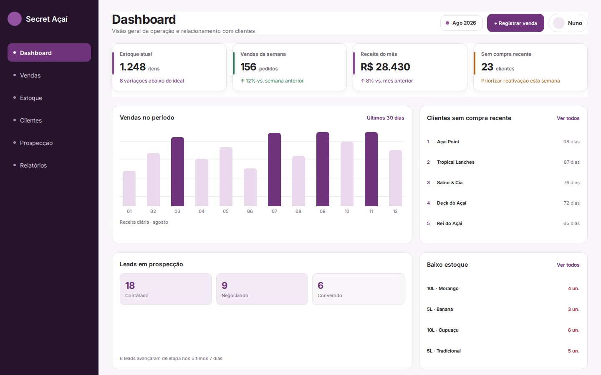
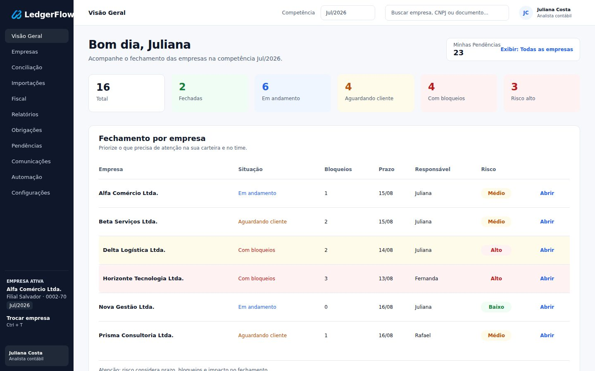

# Front-End Portfolio — Graziele Costa

**UX/UI Designer · Product Designer · Front-End Developer**

I turn original design work into responsive, functional browser interfaces. This repository brings together three front-end implementations, with direct access to **live demos, source code and their Figma references**.

**[Explore the live showcase](https://ohgrazidesigner-blip.github.io/ux-ui-frontend/)** · **[View my full UX/UI portfolio](https://portfolio-grazi.vercel.app/)**

## Selected work

<table>
  <tr>
    <td width="33%" valign="top">
      <a href="https://ohgrazidesigner-blip.github.io/ux-ui-frontend/cultura-inglesa/">
        
      </a>
      <p><strong>Cultura Inglesa Salvador</strong></p>
      <p>Professional UX/UI work (2018–2019), independently rebuilt as a responsive homepage in 2026.</p>
      <p><strong>HTML · CSS · JavaScript · Leaflet</strong></p>
      <p><a href="https://ohgrazidesigner-blip.github.io/ux-ui-frontend/cultura-inglesa/">Live demo</a> · <a href="./cultura-inglesa/">Code &amp; README</a> · <a href="https://www.figma.com/design/90d1dR1gDk44utANiUe5eR/Cultura-Inglesa-2026">Figma</a></p>
    </td>
    <td width="33%" valign="top">
      <a href="https://ohgrazidesigner-blip.github.io/ux-ui-frontend/secret-acai/">
        
      </a>
      <p><strong>Secret Açaí</strong></p>
      <p>Commercial operations design study brought to life with simulated sales, inventory and customer workflows.</p>
      <p><strong>React · Vite · CSS · localStorage</strong></p>
      <p><a href="https://ohgrazidesigner-blip.github.io/ux-ui-frontend/secret-acai/">Live demo</a> · <a href="./secret-acai/">Code &amp; README</a> · <a href="https://www.figma.com/design/OmJYOxXm1vFodkfZBXwDd3?node-id=116-2">Figma</a></p>
    </td>
    <td width="33%" valign="top">
      <a href="https://ohgrazidesigner-blip.github.io/ux-ui-frontend/ledgerflow/">
        
      </a>
      <p><strong>LedgerFlow</strong></p>
      <p>B2B accounting operations design study with traceable examples, dedicated mobile screens and guarded demo workflows.</p>
      <p><strong>React · Vite · CSS</strong></p>
      <p><a href="https://ohgrazidesigner-blip.github.io/ux-ui-frontend/ledgerflow/">Live demo</a> · <a href="./ledgerflow/">Code &amp; README</a> · <a href="https://www.figma.com/design/79LeQIZXXjuWcoDleD5Pf2?node-id=379-266">Figma</a></p>
    </td>
  </tr>
</table>

*All previews are real Chromium captures of the implemented websites, not Figma mockups. [Browse the six desktop/mobile images](./showcase/assets/).*

## How I approach front-end work

**Design fidelity.** Preserve the original interface's visual hierarchy, brand identity and content instead of replacing it with generic components.

**Responsive interaction.** Adapt desktop and mobile flows deliberately, including keyboard focus, navigation, forms and touch targets.

**Technical transparency.** Explain what actually works in the browser, what is illustrative Figma data, and what would require a backend or production infrastructure.

These three interfaces are **portfolio demonstrations**. Cultura Inglesa is an independent reconstruction of earlier professional UX/UI work — not the institution's official website. Secret Açaí and LedgerFlow are product design studies using illustrative business/accounting records. The demo flows do not process real payments, fiscal documents or approvals.

## Tech and repository map

```text
ux-ui-frontend/
├── README.md                         This overview
├── showcase/                         English recruiter-facing landing page
│   ├── index.html, styles.css, script.js
│   └── assets/                       Real desktop/mobile screenshots
├── cultura-inglesa/                  HTML5 + CSS3 + vanilla JavaScript + Leaflet
├── secret-acai/                       React + Vite + localStorage-backed demo
├── ledgerflow/                        React + Vite + state-only accounting demo
└── .github/
    ├── scripts/                      Browser checks and screenshot captures
    └── workflows/                    CI and GitHub Pages publication
```

## Local development and verification

| Project | Local setup | Verification |
| --- | --- | --- |
| Cultura Inglesa | Serve `cultura-inglesa/` using a local HTTP server; no package install | [Browser checks](./.github/workflows/validate-cultura-inglesa.yml) |
| Secret Açaí | `cd secret-acai && npm install && npm run dev` | [React build and browser checks](./.github/workflows/validate-secret-acai.yml) |
| LedgerFlow | `cd ledgerflow && npm install && npm run dev` | [React build and browser checks](./.github/workflows/validate-ledgerflow.yml) |

For a production-style build of either React app, run `npm run build` inside its folder. Both Vite apps use a relative base path to work under GitHub Pages subdirectories.

The [Pages workflow](./.github/workflows/deploy-secret-acai-pages.yml) deploys the English showcase at the repository root and the three demos at their own paths. The [showcase validation](./.github/workflows/validate-showcase.yml) checks viewport layouts, screenshot switching, links and automated axe accessibility rules.

The November 2026 automated audits passed for the covered checks; **manual accessibility and visual review remain necessary**. Automated WCAG rule scans are not a formal conformance certification.

## What to explore first

For **Front-End Developer** roles, open the live demos and inspect the component structure, JavaScript interactions, responsive CSS and test workflows. For **Web Designer / UX/UI** roles, follow each project's Figma case to see the visual design and how it was translated into code.

**[Launch Front-End Showcase](https://ohgrazidesigner-blip.github.io/ux-ui-frontend/)** · [Full design portfolio](https://portfolio-grazi.vercel.app/)

---

Created by **Graziele Costa** · UX/UI, Product Design & Front-End.
