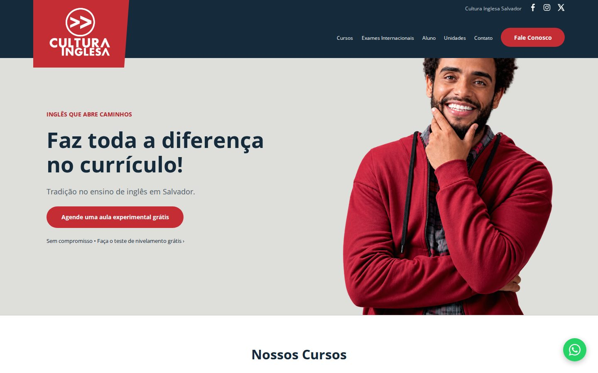

# Cultura Inglesa Salvador — UX/UI & Front-End

**Professional UX/UI work: 2018–2019 · Independent front-end reconstruction: 2026**

I worked on Cultura Inglesa Salvador's digital experience as part of its marketing team in 2018–2019. In 2026, I returned to that design work and implemented the homepage independently using HTML, CSS and JavaScript. I used the visual design as my reference and **did not reuse the original website's source code**.

**[Live demo](https://ohgrazidesigner-blip.github.io/ux-ui-frontend/cultura-inglesa/)** · **[Figma case study](https://www.figma.com/design/90d1dR1gDk44utANiUe5eR/Cultura-Inglesa-2026)** · [Front-end showcase](https://ohgrazidesigner-blip.github.io/ux-ui-frontend/)

[](https://ohgrazidesigner-blip.github.io/ux-ui-frontend/cultura-inglesa/)

*Screenshot captured from the implemented page, not a Figma mockup. [View mobile capture](../showcase/assets/cultura-inglesa-mobile.jpg).*

## Project context and my contribution

**2018–2019 — UX/UI design.** My work included improvements to hero calls to action and course navigation, campaign landing pages for different educational offerings, contact/conversion paths and a Cambridge exam information flow. A three-step lead-form concept and additional landing pages are shown in the [Figma case](https://www.figma.com/design/90d1dR1gDk44utANiUe5eR/Cultura-Inglesa-2026); **they are not all implemented as separate pages in this repository**.

**2026 — front-end development.** I rebuilt the homepage from scratch, keeping the original brand visual language while adding responsive behavior and browser interactions. The result is a **portfolio demonstration**, not an official Cultura Inglesa deployment.

## Implemented features

- Responsive homepage with courses, exams, news, school locations and newsletter sections.
- Desktop navigation plus a mobile menu with keyboard focus management and an Escape-to-close interaction.
- Demo lead and newsletter forms with client-side validation, accessible error messages and confirmation dialogs. **No form data is sent or saved.**
- Four location entries: Pituba, Ondina, Graça and Vilas do Atlântico; an interactive Leaflet map with custom markers, labels and accessible zoom controls.
- Floating WhatsApp unit selector for **Pituba, Graça and Ondina**; choosing a unit navigates to its contact card rather than starting an unverified chat.
- Dictionary selector that forwards a term to a third-party dictionary website; the site does not implement its own dictionary service.

## Technology and structure

| Layer | Implementation |
| --- | --- |
| Markup | Semantic HTML5 with Portuguese-language content |
| Styling | CSS3, responsive layouts, custom properties and visible keyboard focus |
| Interactions | Vanilla JavaScript; DOM events and browser form validation |
| Locations | Leaflet 1.9.4, OpenStreetMap tiles, optional CARTO Positron setup |
| Build | Static files; no framework, bundler or backend |

```text
cultura-inglesa/
├── index.html          Homepage and accessible forms
├── css/styles.css      Layouts and responsive design
├── js/main.js          Navigation, forms, locations and interactions
├── js/map-config.js    Optional CARTO tile configuration
├── assets/             Project imagery and icons
└── README.md
```

## Design-to-code decisions

The original homepage includes a static location visual. I implemented the locations section as a Leaflet map, with a fallback image if the map library cannot load. OpenStreetMap is used by default. Optional CARTO Positron tiles require a configured API key; that key is visible in client-side requests and should be domain-restricted.

Where a browser interaction could mislead someone — such as submitting a contact form or choosing WhatsApp — the demo shows a clear local result rather than pretending to contact the institution. The implemented content follows the design reference without inventing new landing pages or rebranding the project.

## Accessibility and validation

The implementation includes a skip link, semantic page landmarks, labelled controls, live form errors, keyboard focus handling, accessible dialog titles and reduced-motion support. The locations map exposes a labelled region and keyboard-reachable controls.

The repository has an **automated browser validation workflow** at [`validate-cultura-inglesa.yml`](../.github/workflows/validate-cultura-inglesa.yml) with [Playwright-based interaction, responsive and axe checks](../.github/scripts/cultura-browser.cjs). The audit performed in November 2026 reported no confirmed violations for the tested WCAG A/AA rules. This is **not** a full manual accessibility audit, screen-reader verification or WCAG certification.

## Demo limitations and data integrity

- This is an independent recreation, not the official institution's website.
- Form submissions and newsletter signups are **demonstrations**; there is no API, CRM integration or messaging backend.
- The WhatsApp selector does not initiate a conversation or use a guessed phone number.
- Testimonials and illustrated portraits used to complete the page are **fictional**, not student endorsements.
- Addresses, phone details and coordinates draw from historical project references and must be verified before any real institutional use.
- Institutional statistics are not exclusively Salvador-specific; exams shown for context do not prove individual-site accreditation.
- External Leaflet resources and map tiles require network access. A fallback is available when the library does not load.

## Run locally

No dependencies are required. Open `cultura-inglesa/index.html` with a local web server (for example, VS Code Live Server), or from the repository root:

```bash
python3 -m http.server 8080 --directory cultura-inglesa
```

Visit `http://localhost:8080`. For the interactive map, keep an internet connection available. To enable optional CARTO tiles, configure `cartoApiKey` in [`js/map-config.js`](./js/map-config.js) with a **domain-restricted** key.

---

**My role:** UX/UI design (2018–2019); independent front-end development (2026).  
**Scope:** Portfolio reconstruction of one homepage and its supported browser interactions.
