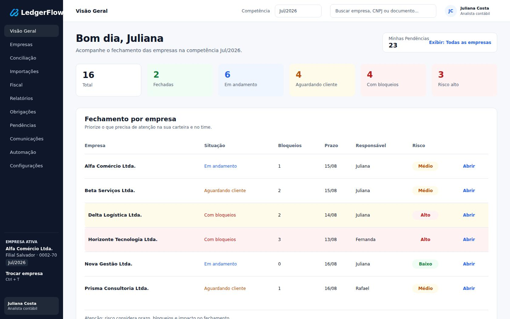

# LedgerFlow — accounting operations, explored in React

**Product Design study and front-end demonstration, 2026**

LedgerFlow looks at an accounting workspace where teams move between companies, imports, reconciliation, obligations and closing. I designed the flows in Figma, then built the selected screens in React to explore their behaviour on desktop and mobile.

[Open the demo](https://ohgrazidesigner-blip.github.io/ux-ui-frontend/ledgerflow/) · [Figma case](https://www.figma.com/design/79LeQIZXXjuWcoDleD5Pf2?node-id=379-266) · [Front-end portfolio](https://portfolio-grazi.vercel.app/frontend/)



[Mobile screenshot](../showcase/assets/ledgerflow-mobile.jpg)

## What I worked on

The desktop interface brings company status, imports, pending items, fiscal obligations, reports and accounting-closing steps together. In the mobile version, I used dedicated Figma views for priorities, company context and navigation rather than squeezing full desktop tables into a phone screen.

Some interactions are intentionally guarded. The closing flow asks for confirmation; reopening asks for a reason. A local file can be selected to demonstrate the supporting-document step, but **it is not uploaded**. Those changes live in React state and reset when the page reloads.

## How the code is organised

- **React 19, Vite 6, CSS** for the interface
- `src/App.jsx` for the shell, companies and detail view
- `src/Modules.jsx` for accounting workflows and example reports
- `src/MobileViews.jsx` and `src/MobileModules.jsx` for the smaller-screen experience
- `src/GuardedDialog.jsx` for confirmations and keyboard focus

Playwright and axe-core are used **for testing**, not as part of the interface stack.

## Design evidence and its limits

The Figma case describes eight participants in two rounds using static design screens. Those observations belong to the design study. This demo doesn't collect usage analytics or measure a reduction in accounting errors.

Company names, CNPJs, values and transaction examples are illustrative. There are no bank connections, fiscal submissions, production approvals, tenant permissions or persistent audit records.

## Run locally

```bash
cd ledgerflow
npm install
npm run dev
```

Use `npm run build` and `npm run preview` to inspect the compiled site. The [browser checks](../.github/workflows/validate-ledgerflow.yml) cover responsive layouts, sample workflows and automated accessibility rules. Manual assistive-technology testing is a separate step.

The goal of this project is to show the design decisions alongside the code that implements them, while keeping the boundary between a working front-end and a production accounting service clear.
