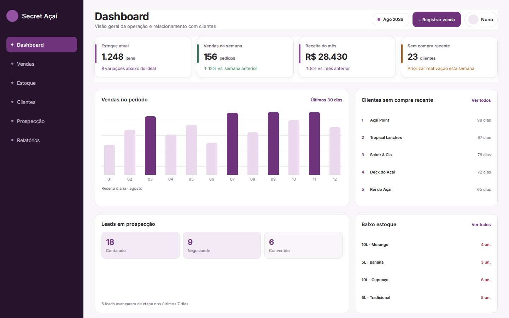

# Secret Açaí — Sales & Operations Platform

**Product design case study (2026) · React front-end implementation (2026)**

A responsive commercial operations interface translated from the original Secret Açaí Figma design into a working React demonstration. It brings sales registration, inventory, customer records, prospecting and reporting into one consistent navigation system.

**[Live demo](https://ohgrazidesigner-blip.github.io/ux-ui-frontend/secret-acai/)** · **[Figma case study](https://www.figma.com/design/OmJYOxXm1vFodkfZBXwDd3?node-id=116-2)** · [Figma screens](https://www.figma.com/design/OmJYOxXm1vFodkfZBXwDd3?node-id=0-1) · [Behance case](https://www.behance.net/gallery/254661851/Secret-Acai-Sales-Operations-Platform)

[](https://ohgrazidesigner-blip.github.io/ux-ui-frontend/secret-acai/)

*Actual front-end screenshot, not a Figma mockup. [View mobile capture](../showcase/assets/secret-acai-mobile.jpg).*

## Project context and my contribution

The objective was to translate the original product design into a usable, responsive **front-end demonstration** while preserving its sample content, typography, visual hierarchy and business vocabulary. This implementation uses independently written React components and local browser state; it **does not** reuse or claim access to a company's production code or data.

## Implemented modules

| Module | Implemented behavior |
| --- | --- |
| **Dashboard** | August 2026 reference KPIs, sales chart, low-stock indicators and navigation to operational sections |
| **Sales** | Customer and product selection, quantities, final-price entry, simulated discount confirmation, order confirmation and stock deduction |
| **Inventory** | Eight sample product variants, size/flavour/status filters, stock entry and correction forms, movement history |
| **Customers** | Search and filters, sample customer records, client registration and reactivation review |
| **Prospecting** | Three-stage lead board, search/filter, lead creation and follow-up editing |
| **Reports** | Illustrative period views, sample charts and browser print/export flow |

The mobile experience uses a slide-out navigation drawer and content layouts adapted for narrow screens. Supported forms, dialogs, filters and navigational actions are implemented; visually present elements without a connected service are described as demonstrations.

## Working front-end interactions vs illustrative data

**Interactive and persisted in this browser:** supported simulated sales, stock adjustments, customer records, leads and local movement history. These actions are backed by React state and `localStorage`. Changes stay on the same browser/device and are not synchronized with other users.

**Illustrative, not live:** the Dashboard KPIs, historical sales charts, stock **summary totals** and monthly report figures are **fixed design snapshots** from August 2026. A newly entered sale can update the local inventory table and movements **without recalculating** those historical Dashboard/report values. The distinction is intentional: static reference values must not be presented as real-time commercial analytics.

**Not connected:** login, server data storage, real payments, WhatsApp messaging, managerial approval, server-generated PDFs, historical BI, Supabase/Postgres or other access-control services. Printing a report uses the **browser's** print-to-PDF capability, not a server-generated file.

## Technology and architecture

| Area | Implementation |
| --- | --- |
| UI | React 19 and React DOM |
| Tooling | Vite 6 with the React plugin |
| Styles | CSS, Grid/Flexbox, custom properties and responsive layout rules |
| State | React hooks and a localStorage-backed `useStored` helper |
| Behavior | Client-side forms, validation, conditional dialogs and calculated demo quantities |
| Deployment | Static Vite build published at a GitHub Pages subpath |

```text
secret-acai/
├── index.html
├── package.json
├── vite.config.js      Relative base path for GitHub Pages
├── src/
│   ├── main.jsx        React entry point
│   ├── App.jsx         Shell, sidebar, dashboard and navigation
│   ├── Modules.jsx     Sales, inventory, customers, leads, reports
│   ├── styles.css      Shared layout and visual tokens
│   └── modules.css     Module-specific styling
└── README.md
```

The code keeps the dashboard shell separate from the operational modules. The demo's small data seeds and browser persistence are deliberately local: replacing them with a real service would require authentication, data modelling, business-rule validation and server-side permissions, none of which are represented as implemented here.

## Accessibility and quality checks

The interface includes responsive navigation, explicit labels for module filters, keyboard interaction with dialogs, Escape handling, focus restoration and focus containment in open modal flows.

The repository's [Secret Açaí CI audit](../.github/workflows/validate-secret-acai.yml) builds both React projects and runs [Playwright browser tests](../.github/scripts/secret-acai-browser.cjs), including responsive widths, a simulated sale, stock persistence, dialog navigation and automated axe WCAG A/AA scanning. The November 2026 run reported **zero automated violations** across the six tested modules. This does **not** replace manual screen-reader testing, or certify full WCAG conformance.

## Key design-to-code decisions

1. **Keep original content and visual language.** The implementation follows the source Figma instead of replacing it with a generic admin template.
2. **Protect high-impact actions in the UI.** Pricing/discount rules and stock effects are demonstrated through explicit confirmation steps. No real manager approval occurs.
3. **Respect responsive navigation.** The mobile drawer is excluded from keyboard navigation when hidden and manages focus when open.
4. **Make the prototype's boundary obvious.** Historical KPIs remain static even when example records in localStorage change.

## Run locally

From the repository root:

```bash
cd secret-acai
npm install
npm run dev
```

For a production-style local build:

```bash
npm run build
npm run preview
```

The Vite configuration uses `base: "./"` for deployment at a relative GitHub Pages subpath. There is no backend service or configuration secret to provide.

---

**Scope:** Design-to-code portfolio demonstration. **All** customers, sales values and other displayed business records are illustrative, not production records.
